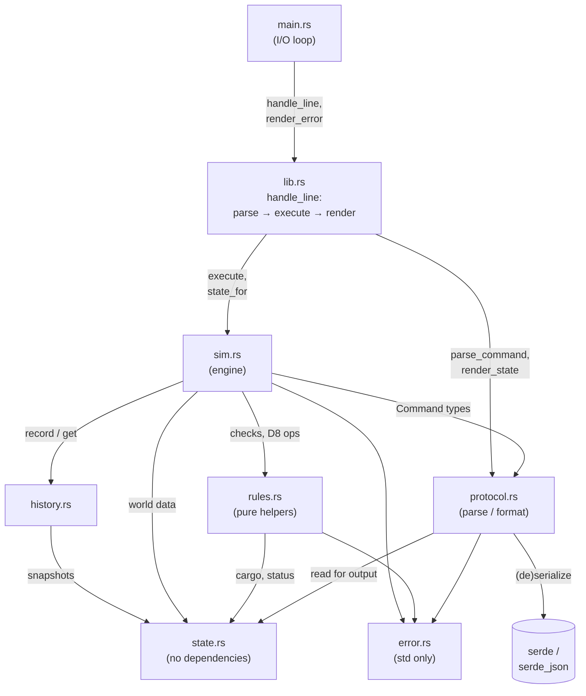
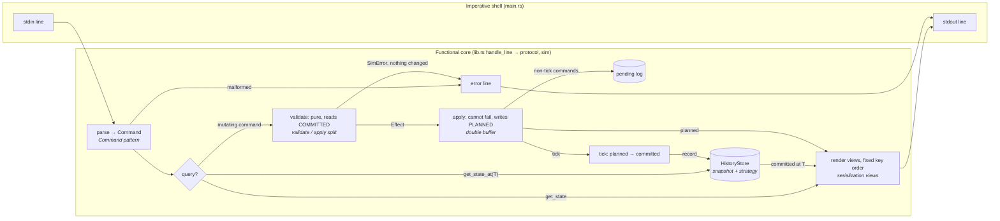

<!--
DESIGN DOC TEMPLATE: Fleet Simulation Engine
Structure adapted from MIL-STD-498 Software Design Description (DI-IPSC-81435),
trimmed for a take-home; decisions use the Architecture Decision Record (ADR) format.

HOW TO USE
- Save as docs/DESIGN.md in the repo. Every sentence must be your own writing: the spec
  forbids AI for the design doc. These hidden comments are questions to answer; delete
  each one once its section is written.
- Target length: about 5-8 pages. Short, specific sentences beat long ones.
- Use the spec's words for spec facts and your own words for everything else.
-->

# Fleet Simulation Engine: Software Design Description

|                  |            |
| ---------------- | ---------- |
| Author           | John Lee   |
| Version / commit | 1.0 (code at `5b2234b`) |
| Date             | 10/25/2026 |
| Status           | Submitted      |

## 1. Scope

### 1.1 Identification

This program is called Fleet Simulation Engine and implements the base spec, Follow-on 1 (cargo, dock), and Follow-on 2 (historical state queries).

### 1.2 System overview

The program simulates vessels moving between different numbered locations, with their travel times represented as a weighted graph. It simulates docking at these locations and moving cargo to and from locations during docking. Time is measured via discrete turns, or ticks. The simulation is driven by another program, which sends JSON commands and reads responses. The simulation accepts strict JSON and outputs exactly one response per line on stdout, either `ok` with the world state or `error` with a message.

### 1.3 Document overview

This document covers the simulation's core model and decisions, architecture, detailed design, traceability, verification, and limitations.

### 1.4 Goals and non-goals

My goals were ranked as follows:

- Correctness: My implementation should match the spec entirely.
- Determinism: Same inputs should get the same output for reproducibility and error testing.
- Efficiency: Making sure the program has low latency, uses low memory.
- Reducing Tech Debt: The program should have clean seams for modularity and future development.

Correctness comes first because a fast, wrong answer is useless to the grader and the program running the sim.

My non-goals were as follows:

- Networking: No need for networking in this project, since the interface is already defined as stdin/stdout.
- Persistence: No need for data to outlive one run of the program. Determinism also allows recreatability.
- Multithreading: The work is inherently sequential, and commands are processed in order. While validation does not check order, command results depend on order.
- Wall-clock time: Ticks serve as the unit of time and increment the world state forward.

## 2. Referenced documents

- Saronic Interview Project, 10/22/2026
- Rust docs
- serde docs
- MIL-STD-498 Software Development Design structure
- [Architecture Decision Records](https://adr.github.io/) docs

## 3. System-wide design decisions

### 3.1 Core model: committed vs. planned state

- The committed state shows the world as of the last tick. The planned state is the committed state plus this tick's accepted commands.
- `get_state` returns the planned state, and `get_state_at` returns a past committed snapshot.
- A tick is a turn, not real time. At the boundary, tick increments, arrivals are processed, manifest cargo is added to docks, planned becomes committed, the snapshot is recorded, and pending is cleared.
- Arrivals and manifest are part of tick T's committed state, so a vessel arriving at T reports idle at T.
- The spec's part 4 has committed/planned definitions and tick semantics.

### 3.2 The golden rule

The main philosophy that drove my design decisions was that validity of a command is checked against the committed state. A valid command replaces that vessel's pending command, meaning the last one wins. Cargo amounts are checked against the planned state.

Due to this rule, every decision in 3.5 is predictable because every decision follows it.

### 3.3 Behavior and error handling

The simulation caller always receives `{"status":"error","payload":{"message":...}}` when a command fails. This guarantees that a rejected command changes nothing, since commands are validated first and then applied. Because of this, applying commands cannot fail. The simulation caller thus never has to worry about a half-applied command. For example, because of this rule we know for certain that every unit of cargo appeared through `init` or a tick's manifest, and leaves only by delivery.

### 3.4 Determinism

The simulation's determinism requires no wall-clock time, no unseeded randomness, and no hash-map iteration in the output. This enables byte-for-byte golden tests, reproducible random tests from a seed, and replay for history, crash recovery, or replicas.

### 3.5 Implementation decisions (ADR format)

#### D1: `set_destination` to current location

- **Context:** The spec asks what should happen when the vessel is idle at location 0 and receives `set_destination(0)`.
- **Decision:** The program accepts the command and the planned state is idle at the current location. This acts as a cancel of a pending trip/dock.
- **Rationale:** Since committed is idle, this is valid under the golden rule that checks for the committed state. The result is that the planned state is idle at the current location, and nothing moves. A 0-tick trip would give `arrives_at_tick = T`, but the spec states that a vessel arriving at T is supposed to report idle, so that model contradicts itself. `arrives_at_tick = T` is already past when the next tick moves to `T+1`, so the arrival check would never fire without a special case. One useful side effect is that it overrides a pending trip or dock, which gives a way to "stay put".
- **Alternatives rejected:**
  - Returning an error: The command is harmless, it follows the golden rule, and an error would surprise the user.
  - Model as transit with t = 0: Contradicts the spec, since vessels that arrive at that tick must report idle.
- **Consequences:** This follows the "last-one-wins" thought process. The command is valid (committed idle), replaces the pending command, and its result happens to be "stay idle". This effect only reaches pending docks and trips, not those that have already committed. This suggests a "cancel" feature that users might expect to cancel a pending command in the planned state. Currently, only this command allows an intuitive cancel, which could make users ask for a cancel command.
- **Verified by:** `d1_set_destination_to_current_location_stays_idle_and_cancels_pending_trip`, `d1_set_destination_to_current_location_cancels_pending_dock`

#### D2: `dock` after `dock`

- **Context:** The spec asks what happens if the user commands the vessel to `dock` after `dock`.
- **Decision:** If the user issues `dock` twice in the same tick, the program accepts and there is no change. If the user doubly commands `dock` in consecutive ticks (i.e. committed is docked), then the program throws an error.
- **Rationale:** Docking twice in the same tick is valid because the committed state is idle, so the second dock changes nothing. The command is idempotent within ticks, like pressing an elevator button twice. Docking when the vessel is committed docked is impossible because a dock command requires the committed state to be idle. The spec also states that a pending dock must be overridable by set_destination, and vice versa. Commanding a dock before a tick cancels a pending journey set by set_destination, and setting course with set_destination cancels a pending dock. The last command wins.
- **Alternatives rejected:**
  - Returning an error for both: The committed state is idle, so the golden rule states that the dock is valid.
- **Consequences:** Idempotent repeats hide a client that's sending duplicate requests.
- **Verified by:** `d2_dock_twice_same_tick_is_a_no_op`, `d2_dock_when_committed_docked_is_not_idle`

#### D3: `undock` after `dock`

- **Context:** The spec asks what happens if the user commands the vessel to `undock` after `dock`.
- **Decision:** If the user commands undock after dock in the same tick, the program throws an error. If it commands undock after dock in consecutive ticks, it undocks normally.
- **Rationale:** Across consecutive ticks (committed = docked, planned = idle), the command behaves as a normal undock, since it satisfies the docked committed state. Within the same tick (committed = idle, planned = docked), the program throws an error because the undock command requires the committed state to be docked. I did not want the same-tick undock after dock to be a sort of undo, since that would break the spec's rule that undock requires the committed state to be docked. Adding the functionality that undock cancels a planned dock would add validity requirements that are order dependent. Each command would require the pending log as an input, which would add unnecessary bloat.
- **Alternatives rejected:**
  - Cancel the pending dock and return to idle (serve as a cancel): although some users may argue that this is more intuitive, I would argue that this addition would require more complexity by making validity take in the pending log as an input. Allowing a cancel would open other design decisions that would make validity dependent on the order of the commands. I would advise just adding a separate cancel command for this purpose.
- **Consequences:** A pending dock can only be canceled via D1.
- **Verified by:** `d3_undock_after_pending_dock_is_not_docked`

#### D4: `undock` after `undock`

- **Context:** A logical follow up to D2.
- **Decision:** If the user doubly commands in the same tick, there is no change, similar to D2. If the user doubly commands across consecutive ticks, the program throws an error.
- **Rationale:** If undocking in the same tick, committed = docked, so nothing changes. Same idempotent idea as D2. If undocking across consecutive ticks, committed = idle, so it throws an error. This mirrors D2 exactly with the same pattern.
- **Alternatives rejected:**
  - Returning an error for both: Would be strange for the inverse command of dock to have a different behavior.
- **Consequences:** Again, more test cases. Symmetry with D2.
- **Verified by:** `d4_undock_twice_same_tick_is_a_no_op_but_not_after_tick`

#### D5: `dock` after `undock`

- **Context:** A logical follow up to D3.
- **Decision:** If the user commands dock after undock in the same tick, the program throws an error. If it commands dock after undock in consecutive ticks, it redocks normally.
- **Rationale:** During the same tick, assuming that the undock command is valid, this must mean that committed = docked, and dock requires idle, so the program throws an error.
- **Alternatives rejected:**
  - Cancel the planned undock into planned docked: Is not consistent with D3, causes confusion for the user.
- **Consequences:** Unlike a pending dock, which can be cancelled via D1, a pending undock has no way to be reversed. `get_state` shows idle while the error states "not idle" because `get_state` returns the planned state for that tick.
- **Verified by:** `d5_dock_after_pending_undock_is_not_idle`, `d5_dock_after_committed_undock_redocks`

#### D6: `undock` after `load/unload/swap` during same tick

- **Context:** What happens when you command `undock` after `load/unload/swap` during the same tick?
- **Decision:** Allowed, the cargo changes and the undock command commits together on tick.
- **Rationale:** Breaks nothing in the spec. Committed = docked, so the undock command is valid. On the tick, everything pending commits together. The cargo changes and the vessel undocks. Intuitively, it matches the real world where the vessel finishes loading and then leaves.
- **Alternatives rejected:**
  - Undock cancels pending ops: If the user loads cargo then undocks, the vessel's cargo is not loaded. Adds confusing cancel behavior, also. It also makes command order matter now, since D7 has the same commands but reversed, and that sequence is valid.
  - Reject the undock while the cargo ops are pending: This would break the golden rule because it would check against the planned state instead of the committed state. Undock is valid when the committed = docked, and rejecting it because of the cargo commands would check planned too. See D2. It also makes departing cost an extra tick, which I find unintuitive. Also, this would make the command validity order-dependent, which is what D3 avoids.
- **Consequences:** Allows cargo commands to work in the same tick as the undock, which is what the spec allows. It saves a tick per departure.
- **Verified by:** `d6_load_then_undock_commits_both`

#### D7: `load/unload/swap` after `undock` during same tick

- **Context:** What happens when we use cargo commands when we already commanded to undock in the same tick?
- **Decision:** Allowed, with the same result as the reverse order (D6).
- **Rationale:** Same reasoning as D6, committed = docked, so the cargo commands are still valid. Order doesn’t matter between status and cargo commands, but it can matter between cargo commands that share inventory.
- **Alternatives rejected:**
  - Blocking cargo after undock: it's intuitive, but it's stricter than the spec and makes the command order matter.
- **Consequences:** You can do cargo ops even after undocking. The vessel still leaves, with the cargo.
- **Verified by:** `d7_undock_then_load_is_allowed_and_matches_reverse_order`, `d7_unload_and_swap_after_pending_undock_are_allowed`

#### D8: `load` and `unload` on the same destination cargo

- **Context:** When you load and unload on the same destination, how many operations does that count as (0 or 2)?
- **Decision:** A dock's operations for a tick are the sum, over every vessel docked there, of the larger number between the units that vessel gained, and the units it lost since the last tick, counted per destination. Per vessel ops = max(net loads, net unloads). The command is rejected if the total exceeds the dock's throughput.
- **Rationale:** The spec rejects a command if the new pending state cannot be achieved within throughput. That measures the resulting state, not how many commands were typed. The spec's examples show (2 loads = 2, swap = 1, delivery = 1). This suggests that a swap costing 1 leads to the max(L, U) calculation, since one op can carry one unit on and one off.
- **Alternatives rejected:**
  - Count the commands as 2 ops: This makes the command validity history-dependent, and it also punishes the user for making cargo mistakes during their tick.
    - Also, it could break the economy of the sim. Under command counting, a swap costs half as much as the equivalent load + unload, so the cheapest command depends on phrasing rather than on the result.
  - Counting units moved: contradicts the spec example, since a swap would be 2.
- **Consequences:** Correcting a mistake does not waste capacity. D17 reordering. If the grader counts commands, outputs differ.
- **Verified by:** `d8_load_then_unload_same_unit_costs_zero_operations`, `d8_separate_load_and_unload_cost_one_like_a_swap`

#### D9: v2 load cargo that v1 unloaded at same dock, same tick

- **Context:** v1 unloads a dest-1 unit at dock 0, then v2 loads a dest-1 unit from dock 0.
- **Decision:** Allowed, the inventory is checked against the planned state. Planned dock inventory updates immediately.
- **Rationale:** Inventory must be checked against planned inventory, otherwise the same cargo could be loaded twice, duplicating cargo. Once you check against planned, allowing this follows automatically. Each vessel's ops still count towards the throughput (1 + 1 = 2).
- **Alternatives rejected:**
  - Loads only from committed inventory: Could result in duplicating cargo if two vessels enact cargo commands on the same unit during the same tick.
- **Consequences:** D9 creates a dependency between vessels, and the replay-based cancel has to handle it. Cargo can go from v1 to v2 within one tick, and both vessels’ operations count against throughput. v2’s load is only valid because v1’s unload came first. If they’re reversed, v2’s load fails (no inventory). Cargo validity depends on order, while status validity does not. Any future cancel must replay, not reset. Resetting only v1 would give v1 its unit back while v2 still holds it, which duplicates cargo.
- **Verified by:** `d9_vessel_can_load_what_another_unloaded_and_a_unit_cannot_be_loaded_twice`, `d9_transfer_between_vessels_costs_each_vessel`

#### D10: general `cancel` rule

- **Context:** Is a command that returns a planned state to a committed state within a tick treated as a cancel?
- **Decision:** No command gets implicit undo behavior. Every command is checked against committed state only (e.g. undock has to be docked).
- **Rationale:** A cancel rule would break the spec's literal validity rules, and make validity depend on command order. D3 and D5 would have to accept commands the spec’s own rule rejects (undock without committed docked, dock without committed idle). Validity would need the pending log as an input, so the same command in the same committed state could get different answers depending on what came earlier in the tick.
- **Alternatives rejected:**
  - Allowing for a general cancel rule: Undo would be hidden inside commands that mean something else.
  - Special casing only D3 or D5: Partial cancel rules would make dock and undock behave asymmetrically.
- **Consequences:** A pending undock can’t be reversed within the tick, and a pending dock only via D1. May work on an explicit cancel(vessel) that drops that vessel’s pending commands and replays the rest from committed state, through the same validation as normal commands. Other vessels’ commands can depend on the cancelled ones (D9). Choose between rejecting the cancel (the safe default, so the user cancels dependents first) or cascading (drop the dependents too, with the response listing what was dropped).
- **Verified by:** `d10_no_implicit_undo_validity_ignores_pending_commands`

#### D11: malformed JSON, unknown command, missing parameters

- **Context:** The spec states that every command produces exactly one output line.
- **Decision:** Return an error response, with blank lines skipped.
- **Rationale:** This approach still allows every command to produce exactly one output line, while also ensuring a bad input never crashes the program or breaks the one-line rule.
- **Alternatives rejected:**
  - Crashing on bad input: Violates the one-output-per-command rule.
  - Skipping it with no output: Ambiguous result for the user.
- **Consequences:** If the grader expects an error line for every input line, including blanks, the output could be off.
- **Verified by:** `d11_malformed_input_is_an_error_line_and_changes_nothing`, `blank_lines_are_skipped_and_crlf_is_accepted`, `final_line_without_newline_is_processed`, `invalid_utf8_gets_an_error_line_and_the_loop_continues`

#### D12: invalid `init` data, non-square matrix, non-zero diagonal, non-positive times, duplicate vessel IDs, location out of range

- **Context:** The spec states constraints but not rejection behavior.
- **Decision:** Reject with error. The world stays uninitialized so init can be retried.
- **Rationale:** Follows D11, preventing worlds from being formed from malformed init data.
- **Alternatives rejected:**
  - Allowing the world to be generated: The malformed init data will cause errors down the line.
- **Consequences:** More input testing for init.
- **Verified by:** `d12_invalid_init_is_rejected_and_init_can_be_retried`, `d15_init_manifest_needs_dock_throughput`

#### D13: rejected ticks and time advancement

- **Context:** Does a rejected tick (bad cargo manifest) still advance time?
- **Decision:** No, the whole command is rejected atomically.
- **Rationale:** Any rejected command leaves the world state unchanged. The spec says that the command is rejected. Because of the error, time also does not advance.
- **Alternatives rejected:**
  - Allowing time to advance: This would let errors cascade through the simulation by allowing malformed commands to alter world state.
- **Consequences:** A bad manifest blocks the whole tick, so the caller has to fix it and resend before time can advance. If cargo appears any other way, it's a bug.
- **Verified by:** `d13_rejected_tick_does_not_advance_time`, `random_command_sequences_keep_every_invariant`

#### D14: output ordering: vessels map and cargo lists

- **Context:** Spec examples print cargo in insertion order, and a re-added destination goes to the end (spec swap example). Cargo lists could be ordered by insertion order vs. sorted. Vessels could also be sorted by init order or sorted by ID.
- **Decision:** Cargo printed by insertion order. Vessels printed by init order.
- **Rationale:** Follows examples in the spec.
- **Alternatives rejected:**
  - Cargo lists sorted by destination: The spec shows insertion order behavior.
  - Cargo list keeps zero-quantity entries in place: The spec's swap example removes an entry at 0 and adds it back to the end.
  - Cargo and vessels printed by hashmap-iteration order: Rust randomizes it per run, so the same input could give a different output, breaking determinism and every golden test.
- **Consequences:** The program reorders its cargo order only when an entry is removed and re-added. Under the vessel-sorted-by-ID option, string sorting puts v10 before v2.
- **Verified by:** `d14_vessels_print_in_init_order_and_cargo_in_insertion_order`, `swap_costs_one_and_reorders_like_the_spec`

#### D15: base vs Follow-on 1

- **Context:** Base init has no dock_throughput, but Follow-on 1 states init now "requires" it, and base outputs have no cargo fields.
- **Decision:** One binary, where cargo mode is on iff init includes dock_throughput. An init that includes cargo in its manifest but no dock_throughput is rejected with the cargo-mode error, and the world stays uninitialized (D12). In base mode, any cargo_manifest field is rejected, even an empty one: base mode rejects any mention of cargo. `"cargo_manifest": null` counts as absent and is accepted.
- **Rationale:** One binary passes both sets of examples, with the cargo state acting as an optional part of the world.
- **Alternatives rejected:**
  - Separate stages/branches: Complicates the program, makes testing harder, and goes against KISS principle.
  - Always cargo mode: This breaks the base examples.
- **Consequences:** Cargo commands in base mode return a clear error. A missing dock_throughput means "base mode" instead of an error. A command line flag may be the stricter alternative. This diverges from the original spec's "requires" wording.
- **Verified by:** `d15_base_mode_has_no_cargo_fields_and_rejects_cargo_commands`, `d15_every_cargo_command_is_rejected_in_base_mode`, `d15_init_manifest_needs_dock_throughput`, `d15_base_mode_rejects_any_cargo_manifest_even_empty`, `base_spec_walkthrough`

#### D16: error message text for cases the spec does not show

- **Context:** Scenarios such as unknown vessel, destination out of range, no inventory, command before init, second init, malformed input.
- **Decision:** Keep a fixed message set, defined in one error enum. Messages follow the spec's style: start lowercase, no trailing period.
- **Rationale:** Since the spec only gives a few messages, create new messages that follow the same style: lowercase, name the vessel, location or tick, and say what's wrong.
- **Alternatives rejected:**
  - N/A
- **Consequences:** All messages live in one place in the error enum's Display, so changing wording is a one-line edit, and easy to test. Grading risk if the grader compares error text.
- **Verified by:** `d16_every_error_message_is_pinned`

#### D17: command sequence that changes nothing can still change order of printed list

- **Context:** `load` then `unload` applied to the same destination reorders the list. D14 says cargo prints in insertion order, an entry is removed when it reaches 0, and re-added entries go to the end.
- **Decision:** Accept the reordering.
- **Rationale:** It's a direct and predictable consequence of D14 and the simplest rule. The contents are always correct with only the position changing.
- **Alternatives rejected:**
  - Preserve position within a tick: Doable, but adds unnecessary bloat and testing. Could be a possible avenue later on.
- **Consequences:** The side effect is that "remove, then re-add" moves an entry to the back. Grader risk if the grader compares order strictly.
- **Verified by:** `d17_load_then_unload_moves_dock_entry_to_end`, `d17_unload_then_load_moves_vessel_entry_to_end`

#### D18: Using `swap` on crates with the same destination

- **Context:** Follow up from D8. A swap's load and unload destinations can be the same. Cargo has no identity beyond its destination, so the vessel's and dock's counts don't change. The spec's example (different destinations) costs 1 op. It says nothing about the same destination case.
- **Decision:** A same destination swap is accepted and costs 0 operations. It stems from D8, where the planned state = committed state, so the net change is 0.
- **Rationale:** The spec's throughput check is on the resulting pending state, and this swap leaves the state unchanged. Since load + unload of the same destination already costs 0, charging 1 for a swap would give two different prices for an identical outcome. Pricing by outcome means no combination of commands is cheaper than another for the same result, so there's no arbitrage to exploit.
- **Alternatives rejected:**
  - Cost 1 (literally every swap is 1 op): Contradicts state based wording and D8, and creates an arbitrage between swap and load + unload for the same result.
  - Reject the command: It's valid by every rule, so rejecting it would be a special case.
- **Consequences:** Cost depends only on the result everywhere in the simulation. This interpretation diverges from the literal reading of the spec. D17's reordering.
- **Verified by:** `d18_same_destination_swap_costs_zero_operations`, `d18_same_destination_swap_changes_no_cargo`, `d18_every_path_to_the_same_state_costs_the_same`

## 4. Architectural design

### 4.1 Components

| Module | Responsibility | Why separate |
| --------- | -------------- | ------------ |
| `main.rs` | I/O loop, reads the lines, writes, and flushes | Only file that touches the stdin/stdout. Single threaded on purpose and flushes out command after every response. |
| `lib.rs` | Crate root that declares modules and re-exports the public API. Owns `handle_line`, which parses, executes and renders, and is the only place where protocol and sim meet | Lets tests drive the engine without the binary |
| `protocol.rs` | Parses JSON into Commands and formats the world state back into JSON with a fixed key order. It never calls the engine and depends only on `state`, `error`, and serde. | The internal model and JSON shape can change independently, and output can be tested without a running world. |
| `sim.rs` | The sim engine, includes `validate`, `apply`, and `advance` for ticks. | Holds every ordering decision. The validate/apply split is what makes rejections atomic. |
| `rules.rs` | Pure rule helpers. No I/O, no mutation. | Unit testable with plain values. The throughput rule lives in one place. |
| `state.rs` | Plain data model. | No rules, no I/O. Holds the topology of the world state, so travel time data can be isolated here. |
| `history.rs` | Committed snapshots for `get_state_at` | A trait so the storage can be swapped, and future changes to history can be altered in isolation. |
| `error.rs` | Every error and its message | All wording in one place. |

Dependencies for the architecture.

Unlabelled arrows into `error` mean the module returns `SimError`.

### 4.2 Concept of execution

An example of a command is as follows:

1. `main.rs` reads the line and handles invalid UTF-8.
2. `handle_line` in `lib.rs` trims the line, and `protocol::parse_command` deserializes it into the `Command` structure. Unknown commands, extra fields, and wrong types fail here with `InvalidCommand`.
3. `sim.rs` sees an existing world and forwards the command via `Simulation::execute`. `World::execute` answers `Init`, `GetState`, and `GetStateAt` early without calling `validate`. A `Load` then goes into `validate`.
4. `validate` runs checks in order. Dock commands get checked against the committed state, and cargo commands are valid only if the vessel is committed-docked. Only the inventory and throughput checks read planned state. `dock_operations` sums over every vessel whose committed status is docked at that dock.
5. Because of the rigorous validation in the previous step, `apply` cannot fail. The planned state is updated.
6. Because time has not passed yet via a `tick`, the raw `Command` is pushed onto `pending`, and the function returns `View::Planned`.
7. `handle_line` calls `state_for(Planned)`, which borrows the planned state, then passes the vessel names, that state, and the cargo mode to `protocol::render_state`. `StateView` writes `tick`, then `vessels` in `names` order. This is init order, not HashMap order. Then, it writes the cargo.
8. `main` writes a line and a newline, then flushes.

A tick's trace is as follows:

1. `sim.rs` validates the command and checks for a `cargo_manifest`. If a bad manifest is given, the tick is rejected and tick does not advance. Any manifest in base mode is rejected with `CargoNotEnabled`.
2. The tick is then applied through `advance`. This changes `planned` in place (tick increments, arrivals processed, and manifest added), then promotes it to committed. The tick's snapshot is stored in `SnapshotHistory`, and `pending` commands are cleared.

Notable things in the implementation:

1. "Last one wins" overwrites `planned.vessels[v].status`. `pending` is written but never actually read by `validate`, `apply`, or `advance`. It exists solely for the future `cancel`/replay.
2. Status and cargo commands can't be mixed in one tick.
    - `dock` and `set_destination` need the committed state to be Idle.
    - `undock` and the cargo commands need it to be Docked.
    So the only mix allowed is `undock` plus cargo commands (D6/D7). Both change different fields of planned, so their order doesn't matter.

#### Lifecycle of one command. Each step's italic label names the design pattern it uses.

### 4.3 Interface design

The simulation uses the stdin/stdout protocol, with the input shape mirroring the spec's examples. Each input gets exactly one output, either an ok or an error.

- The simulation accepts one JSON object per line, `{"command": <name>, "parameters": {...}}`. Unknown commands, unknown or missing fields, and wrong types are rejected.
- On success, the simulation outputs: `{"status":"ok", "payload":{tick, vessels[, cargo]}}`
- On error, the simulation outputs: `{"status":"error","payload":{"message":…}}`
- The field order inside includes:
  - `state` first
  - then `location` (idle or docked) or `from/to/arrives_at_tick` (transit)
  - then `cargo`

Blank lines are skipped, malformed inputs get error responses, CRLF line endings are accepted, output is flushed after every line, output field order follows D14, and the presence of `dock_throughput` in `init` decides whether cargo fields appear in responses.

### 4.4 Resource usage

- The bottleneck is rendering the full world on every response. It has a time complexity of O(vessels). It does not depend on locations, and is more than 99% of an accepted command's cost at 1,000+ vessels.

#### Time per command vs. vessels

Release build, 20 locations, cargo mode on, single-threaded, median of 3 runs on a Windows 11 laptop.
Times are per command and do not include writing to stdout.

| Vessels | Parse | `set_destination` (engine) | `load` (engine) | Render response | Response size | Rejected command (total) | `tick` (engine) | History growth per tick |
| ------: | ----: | ------: | ------: | ------: | ------: | ------: | ------: | ------: |
| 10 | 0.32 µs | 0.16 µs | 0.19 µs | 1.4 µs | 545 B | 0.73 µs | 0.7 µs | 674 B |
| 100 | 0.32 µs | 0.15 µs | 0.25 µs | 9.2 µs | 4.8 KB | 0.74 µs | 3.2 µs | 5.7 KB |
| 1,000 | 0.33 µs | 0.13 µs | 0.81 µs | 85 µs | 48 KB | 0.74 µs | 26 µs | 56 KB |
| 10,000 | 0.35 µs | 0.22 µs | 8.0 µs | 847 µs | 494 KB | 0.80 µs | 207 µs | 560 KB |
| 100,000 | 1.0 µs | 0.92 µs | 299 µs | 12.1 ms | 5.0 MB | 1.9 µs | 3.9 ms | 5.6 MB |

- Parse and **`set_destination`** stay at or below about **1 µs** at every fleet size. A rejected command (parse, validate, and render a short error line) does too.
- Render is **O(vessels), about 85 ns and 50 B per vessel** up to 10,000 vessels, rising to about 120 ns at 100,000 vessels. It is more than 99% of the cost of an accepted command at 1,000 vessels or more.
- `load` is **O(vessels)**: `rules::dock_operations` checks every vessel to find the ones docked at the location.
- `tick` is **O(vessels)**: an arrival scan plus two full copies of the world (`committed = planned.clone()` and the history snapshot).

#### Time per command vs. locations

Release build, 1,000 vessels, cargo mode on, single-threaded, median of 3 runs on a Windows 11 laptop.
Times are per command and do not include writing to stdout.

| Locations | `init` | World memory after `init` | Parse | `set_destination` (engine) | `load` (engine) | Render response | Response size | `tick` (engine) | History growth per tick |
| --------: | -----: | ------: | ------: | ------: | ------: | ------: | ------: | ------: | ------: |
| 10 | 0.6 ms | 0.3 MB | 0.33 µs | 0.16 µs | 0.82 µs | 81 µs | 48.0 KB | 30 µs | 56 KB |
| 100 | 0.9 ms | 0.3 MB | 0.33 µs | 0.15 µs | 0.86 µs | 80 µs | 48.8 KB | 28 µs | 56 KB |
| 1,000 | 20 ms | 4.3 MB | 0.33 µs | 0.16 µs | 0.82 µs | 83 µs | 49.9 KB | 26 µs | 56 KB |
| 3,000 | 181 ms | 36.3 MB | 0.33 µs | 0.16 µs | 0.82 µs | 84 µs | 49.9 KB | 27 µs | 56 KB |

- Per-command cost is flat in N, because travel time is just a single array lookup.
- Only `init` and memory grow, as $N^2$. 4 B per pair, resulting in 36 MB and 181 ms at N = 3,000.
- Response size grows only from extra digits in location numbers.
- The real location-related cost is manifest size **$O(E^2)$**. Benchmarks measured about 0.9 s at 64k entries. See Proposal 9b, section 8.

#### Time and memory vs. ticks

- History growth is **`size_of::<Vessel>()` = 56 bytes per vessel per tick** and is never freed.
- Time does not grow with tick count. `get_state_at(0)` takes the same time at tick 5,000 as at tick 0 (about 90 - 125 µs at 1,000 vessels). Only memory grows. See the table in 5.1.

## 5. Detailed design

### 5.1 Data structures

- Vessel status: Stored as an enum with three variants, Idle, Transit, and Docked. This ensures no invalid combinations, which could occur with a struct with a `state:String` and optional fields.
- Cargo lists: A list of (destination, quantity) pairs in insertion order. There are never duplicate destinations or zero quantities. An entry that reaches 0 is removed and a re-added destination goes to the end. This reproduces the spec's print order and is small, so searching beats hashing. Rejected `HashMap` due to the random iteration order that breaks determinism, and `BTreeMap` because it sorts by destination, but the spec prints insertion order.
- Dock inventory: One flat list of (location, destination, quantity) for all docks together, in insertion order. It is the exact shape of the spec's top level cargo array, so printing is a straight walk through the list. However, every lookup now scans the list from the start, so a manifest with E entries costs $O(E^2)$. The fix could be a (location, destination) -> position index next to the list, but would add more complexity.
- Travel times: The NxN matrix stored as one flat, row-major list, read as `travel[from * N + to]`. Since the spec provides the full matrix and since the matrix allows for larger N, a sparse route graph is rejected. This is because the matrix allows for an O(1) lookup and one allocation over the sparse graph.
- Vessel IDs: Each vessel is a `usize` everywhere inside the program. Its string ID appears once in `names` during init order, and `index` is used only to look up an incoming command's ID. This is because there are no string copies in snapshots and init-order output without sorting. Rejected `HashMap<String, Vessel>` due to the random output order and the fact that every snapshot copies every name. Also rejected `BTreeMap<String, Vessel>` because it sorts v10 before v2.
- History: History is stored as `SnapshotHistory` as one committed snapshot per tick, appended in `advance`.

    | Vessels | Per tick | After 1,000 ticks | After 100,000 ticks |
    |--------:|---------:|------------------:|--------------------:|
    | 1,000   | 56 KB    | 56 MB             | 5.6 GB              |
    | 10,000  | 560 KB   | 560 MB            | 56 GB               |

    The planned upgrade is written in Proposal 10A and 10B in 5.3.

### 5.2 Throughput accounting

1. Per vessel, `vessel_operations(committed, planned)` compares the committed cargo with the planned cargo, destination by destination.
    - L (units gained) is the total of every increase.
    - U (units lost) is the total of every decrease, including destinations that disappeared entirely.
    - The cost is max(L, U). One operation can carry one unit on and one unit off at the same time, which is what a swap is.
2. Per dock, `dock_operations` adds up the vessel costs for every vessel whose committed status is docked at that location. A vessel with a pending undock still counts, because its cargo work still happens while docked.

This means that the same result requires the same price, so there is no cheaper phrasing to exploit. Calculations are also net per-vessel. Calculating per dock would allow two vessels to load and unload same destination cargo with a net change (and therefore cost) of 0, when it should be 2.

`validate` builds the vessel's cargo as it would be after the command, substitutes it into the sum, and rejects the command if the total is over the limit. If it fits, `apply` makes the same change for real. Nothing is mutated to test the command. A tick commits only the final planned state, so the real work at the dock is turning committed cargo into planned cargo, and charging for intermediate steps would charge for moves that never happen.

#### Example scenario

**Setup:** vessel v1 is docked at location 0. Dock 0 has throughput 3.

| Destination | Committed | Planned | Change |
| --- | --- | --- | --- |
| 2 | 0 | 2 | +2 |
| 1 | 1 | 0 | −1 |
| 3 | 1 | 0 | −1 |
| 4 | 1 | 0 | −1 |

In this example, the program received commands where v1 loads 2 cargo bound for destination 2, removes 1 cargo bound for destination 1, removes 1 cargo bound for destination 3, and removes 1 cargo bound for destination 4.

| | Value |
| --- | --- |
| Units gained (L) | 2 |
| Units lost (U) | 1 + 1 + 1 = 3 |
| Operations for v1 | max(2, 3) = **3** |

As you can see, the net units gained for v1 is 2, and the net units lost for v1 is 3. Therefore, the maximum between the total loads and unloads is 3.

| Operation | On | Off | Cost |
| --- | --- | --- | --- |
| 1 (swap) | dest 2 | dest 1 | 1 |
| 2 (swap) | dest 2 | dest 3 | 1 |
| 3 (unload) | — | dest 4 | 1 |
| Total | | | 3 |

This table shows the same scenario if the user used `swap` for operations 1 and 2, and an `unload` for operation 3. Since a swap still costs 1, these commands still follow the same cargo calculation we established.

**Result:** 3 operations ≤ throughput of 3, so the commands are  accepted. At throughput 2, it would be rejected. Note that this is for one vessel. If there were multiple vessels, the net change calculation would have to be repeated across vessels and still checked against the throughput.

### 5.3 History

- History is stored as one full copy of the committed world after `init` (tick 0) and after every tick. Planned states and rejected commands are never stored. All storage sits behind `HistoryStore`, which includes `record(&WorldState)` and `get(tick)`. `get` returns `Cow`, so a store can hand back a saved copy or a rebuilt one without callers changing.
- `get_state_at(T)` works by validating if T is negative or in the future, then returning a copy number T exactly like `get_state`.
- Worth noting that `get_state_at(current tick)` shows the committed state, so it ignores commands sent this tick. `get_state` includes them, so it shows the planned state as well.
- I chose this design because it was the simpler correct option at a take-home scale, but if I were to change for scale, I would either (10A) save a full copy every K ticks and only the changes in between to save on memory, or (10B) save a full copy every K ticks plus the commands and replay from each save point. The former is simpler, but the latter is useful for crash recovery and a future `cancel` command. See tables in 4.4 and 5.1.

## 6. Requirements traceability

| Spec requirement | Module / function | Test(s) |
| ---------------- | ----------------- | ------- |
| init must be first; second init errors | `sim.rs` `Simulation::execute` (NotInitialized), `World::execute` (AlreadyInitialized), `World::new` | `commands_before_init_are_rejected`, `second_init_is_rejected`, `d12_invalid_init_is_rejected_and_init_can_be_retried` |
| Commands validated against committed state | `sim.rs` `World::validate` (reads `committed` status), `docked_location` | `set_destination_in_transit_is_rejected_with_spec_message`, `set_destination_while_docked_is_not_idle`, `cargo_commands_need_committed_docked`; see D2–D5 |
| set_destination: arrival tick, override before tick | `sim.rs` `validate` (SetDestination → `arrives_at_tick = committed.tick + travel_time`), `apply` (SetStatus) | `set_destination_sets_arrival_and_last_command_wins`, `dock_and_set_destination_override_each_other`, `base_spec_walkthrough`; see D1 |
| Arriving vessel reports idle at its arrival tick | `sim.rs` `World::advance` | `arrival_reports_idle_and_vessel_can_be_commanded_same_tick`, `base_spec_walkthrough` |
| get_state returns planned state | `sim.rs` `World::execute` → `View::Planned`, `state_for` | `get_state_at_current_tick_shows_committed_not_pending`, both golden walkthroughs |
| One output line per command, in order | `main.rs` I/O loop, `lib.rs` `handle_line` | `binary_reproduces_both_spec_walkthroughs`, `blank_lines_are_skipped_and_crlf_is_accepted`, `invalid_utf8_gets_an_error_line_and_the_loop_continues`, `final_line_without_newline_is_processed`; see D11 |
| dock / undock rules and overrides | `sim.rs` `validate` (Dock, Undock) | `dock_and_set_destination_override_each_other`; see D1–D5 |
| load / unload / swap validity | `sim.rs` `validate` (Load, Unload, Swap), `require_dock_cargo`, `require_vessel_cargo` | `cargo_commands_need_committed_docked`, `missing_cargo_is_rejected`, `swap_costs_one_and_reorders_like_the_spec`; see D6, D7, D9 |
| Delivery at destination removes cargo | `sim.rs` `apply` → `unload_into_dock` | `unload_at_destination_delivers_and_removes_cargo`, `delivery_costs_one`, `cargo_and_history_spec_walkthrough` |
| Dock throughput shared across vessels per tick | `rules.rs` `vessel_operations`, `dock_operations`; `sim.rs` `check_throughput` | `spec_third_operation_exceeds_throughput_of_two`, `throughput_is_shared_by_all_vessels_at_a_dock`; see D8, D9, D18 |
| cargo_manifest validation (init and tick) | `rules.rs` `check_manifest`; `sim.rs` `World::new`, `validate` (Tick) | `d12_invalid_init_is_rejected_and_init_can_be_retried`, `d13_rejected_tick_does_not_advance_time`, `d15_base_mode_has_no_cargo_fields_and_rejects_cargo_commands`, `d15_init_manifest_needs_dock_throughput`, `d15_base_mode_rejects_any_cargo_manifest_even_empty` |
| get_state_at returns committed state; future/negative errors | `sim.rs` `check_history_tick`, `state_for`; `history.rs` `SnapshotHistory` | `get_state_at_returns_committed_snapshots_and_rejects_bad_ticks`, `get_state_at_current_tick_shows_committed_not_pending`, `cargo_and_history_spec_walkthrough` |
| Unknown vessel / destination out of range rejected | `sim.rs` `vessel`, `destination`; `rules.rs` `location` | `unknown_vessel_and_out_of_range_destination_are_rejected`, `location_rejects_negative_and_out_of_range` |
| A rejected command changes nothing | `sim.rs` `validate` (pure) then `apply` (cannot fail) | decisions harness (every rejection), `random_command_sequences_keep_every_invariant`; see D13 |
| History never changes; output is deterministic | `history.rs`; no clocks, randomness, or HashMap iteration in output | `random_command_sequences_keep_every_invariant`, `same_seed_gives_byte_identical_output` |

## 7. Verification

- **Unit tests** (`rules.rs`, `state.rs`, `error.rs`, `protocol.rs`): pure helpers in isolation, including throughput counting (D8), cargo-list ordering (D14), and rendering output from a hand-built state with no `World` (`render_state_needs_no_world`).
- **Decision tests** (`tests/decisions.rs`): one or more tests per decision D1–D18 and per spec rule. The shared harness checks every invariant after every command, and checks that every rejected command left the state unchanged. Seven deliberate rule breaks were each caught by their intended test (iteration 9).
- **Golden tests** (`tests/golden.rs`): both spec walkthroughs, compared byte for byte, so any change to output values, key order, or array order fails.
- **Seeded random tests** (`tests/simulation.rs`): 300 seeds × 400 random commands, valid and invalid, checking invariants after every command (`World::check_invariants`), atomic rejections, history that never changes, and byte-identical output for the same seed. A failing seed reproduces with `FLEET_SIM_SEED=<seed>`. The suite was shown to catch a deliberately planted throughput bug before that bug was reverted.
- **CLI tests** (`tests/cli.rs`): checking the binary, run on the fixtures, blank lines, CRLF line endings, and invalid UTF-8.

One script, `scripts/check.sh` (format check, clippy with warnings as errors, all tests), is the gate for every commit. It runs in a git pre-commit hook, in CI on Ubuntu and Windows (macOS when run manually), and in a Claude Code Stop hook before an agent's turn ends. When regression slips through, `scripts/bisect.sh <last-good-commit>` runs git bisect with the gate and names the first bad commit.

## 8. Known limitations and future work

Every item below was found by measurement (section 4.4) or follows from a decision.

[Proposals](PENDING_PROPOSALS.md)

### Performance and scalability

- **Full-world output on every command.** Rendering is O(vessels) and over 99% of the cost of an accepted command at 1,000+ vessels.
  - Next steps: delta responses in `protocol.rs`. Not done because the spec defines full-state output, so this needs the grader's agreement.
- **History memory grows forever** (56 B per vessel per tick).
  - Next steps: **Proposal 10A** (checkpoints + per-tick state diffs) or **Proposal 10B** (checkpoints + command replay, which also touches `sim.rs` but gives a command log for crash recovery, replicas, and `cancel`). Not done because snapshots are the simplest correct design at take-home scale.
- **Large manifests cost O(E²)** (64k entries ≈ 0.9 s per tick).
  - Next steps: **Proposal 9b**, a temporary index used only while applying a manifest (`state.rs`): 73x faster at 64k entries, with no cost elsewhere. A two-map storage design was measured and rejected because it slowed tick copies and rendering 5-40x.
- **Each tick copies the world twice, and `load` scans every vessel.**
  - Next steps: an arrivals index, per-dock vessel lists, and storing only planned changes on top of committed (`sim.rs`, `rules.rs`).
- **One simulation, one thread.**
  - Next steps: an actor-per-simulation server (`main.rs` only).

### Behavior and features

- **D17 ordering quirk:** load then unload of the same destination moves that entry to the end of the cargo list. The contents are correct, only the position changes.
- **No cancel (D10):** a pending dock can only be overridden through D1, and a pending undock cannot be reversed.
  - Next steps: `cancel(vessel_id)`, which drops that vessel's pending commands, replays the rest from committed state, and rejects the cancel if a dependent command (D9) becomes invalid.
- **Not modeled yet:** vessel cargo capacity (a check in `validate`), and docking or loading time (a new `Status` variant, so the compiler flags every `match` to update).

## 9. Notes

### 9.1 Open questions

- What kind of applications will a project like this be used at Saronic?

### 9.2 Glossary

| Term | Definition |
| ------ | ------------ |
| **Tick** | One turn of the simulation, not wall-clock time. A `tick` command advances the clock by one. Vessels whose arrival tick has come become idle, the tick's cargo manifest (if any) is added to the docks, and the planned state becomes the new committed state. |
| **Tick boundary** | The moment a `tick` is processed. It is the only time committed state changes. |
| **Committed state** | The official world as of the last tick. Every validity check reads it (the golden rule), and `get_state_at(T)` prints the committed state recorded at tick T. |
| **Planned state** | The committed state plus every command accepted since the last tick. `get_state` and every command response print this. It becomes the committed state at the next tick. |
| **Pending log** | The accepted commands since the last tick, in order. It is cleared on every tick. Nothing reads it today; it exists for a future `cancel` that would replay it. |
| **Golden rule** | A command is valid only if the committed state allows it. A valid command replaces that vessel's pending command (last one wins). Cargo commands also check planned inventory and dock throughput. |
| **Effect** | The internal result of validating a command, and a description of exactly what to change. `validate` produces it without changing anything, and `apply` carries it out and cannot fail. |
| **Operation** | The unit counted against a dock's throughput. A vessel's operations for a tick are `max(units gained, units lost)` between its committed and planned cargo, counted per destination. A load or an unload is 1, a swap is 1, and load-then-unload of the same unit is 0 (D8). |
| **Dock throughput** | The maximum number of operations a dock allows per tick, summed over every vessel committed-docked there. Set per location at `init`. |
| **Manifest** | A list of (location, destination, quantity) entries that adds new cargo to the docks, given at `init` or with a `tick`. It is validated as a whole: one bad entry rejects the command (D13). |
| **Delivery** | Unloading a unit at its own destination. The unit leaves the simulation instead of returning to the dock, and the world's delivered count goes up by one. |
| **Cargo mode** | The Follow-on 1 features (docking, cargo commands, cargo fields in output). On if and only if `init` includes `dock_throughput` (D15). |
| **Base mode** | Cargo mode off. Only movement commands, and responses have no cargo fields, matching the base spec's examples. |
| **History / snapshot** | A copy of the committed state saved at the end of each tick (tick 0 at `init`). `get_state_at` reads this. Snapshots never change once recorded. |
| **Invariant** | A property that must hold after every command, such as cargo being conserved or no dock exceeding its throughput. `World::check_invariants` checks them all, and the test suite calls it after every command. |
